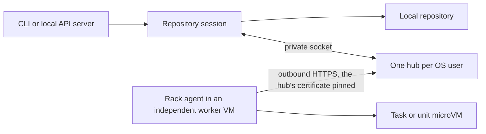

# Local rack delegation

Design of record for [#863](https://github.com/elaraai/east-workspace/issues/863).
The [reconciliation](e3-rack-reconciliation.md) links all ten children and
records how current workspace and e3-cloud main change the original design.
The [setup guide](../packages/e3-rack/README.md) contains runnable commands.

## Goals and non-goals

Delegate expensive stock-runtime task bodies from a local repository, preserve
ordinary e3 cache/results/history, and share one rack fleet across local
projects. Keep planning, repository ownership and local fallback on the
developer machine. Defer custom environments, remote function calls, automatic
reattachment after hub restart and embedded UI integration.

## Topology

The rack initiates every request. The developer machine must remain reachable
for lease polling, object transfer, logs and completion, usually through an SSH
reverse tunnel to a relay: the hub listens on the loopback, and nothing
connects into the developer machine directly. No cloud account or
cloud control plane participates in a local lease. Separate agents occupy
independent worker VMs, with separate identities, encrypted source configuration
and host-enforced resource allocations. Their number and whole-GPU assignments
are mutable through the host lifecycle. There is no cross-agent task scheduler.
The companion managed runtime supports up to 32 mutually trusted sources per
agent. A worker is the trust boundary: sources that do not trust each other,
such as two clients' environments, or a cloud deployment and developer hubs,
need separate worker VMs.

## Package layout

`@elaraai/e3-rack` owns protocol, identity, registry, leases, routes, hub,
client, routing and runner adapters. Its root exports the public local APIs;
`./protocol` exports shared wire types; `./server` exports shared control-plane
mechanisms without local hub/filesystem/runner adapters; `./testing` exports the real-runner
test agent and contract suites; `./hub-main` starts the hub process. Core only
knows the optional task-body hook; it has no dependency on rack code.

The API server consumes an injected dataflow runner factory. `--rack` loads
the optional package at runtime. Its optional peer creates a pnpm scheduling
cycle, although the server has no build-time rack import: build scripts first
compile the server's dependencies excluding rack, then build the full graph.

## Wire protocol

Typed control and rack requests are BEAST2, and a success is the BEAST2 of the
route's own response type, with no envelope. No reply holds a type of e3's
HTTP API: its error variant changes between releases, a rack serves the hubs
of several, a hub the e3 of several projects, and BEAST2 reads a blob only as
the type its header names, so an envelope made every reply unreadable across
releases. A refusal of the rack machine protocol is a status, which says
whether the same request is worth sending again, and JSON
(`{ error: { code, message, retryAfterMs? } }`); the hub's control socket and
a session's data socket refuse with a status and plain text.

The rack machine protocol is numbered (`RACK_PROTOCOL`, 3). Every request
names it in `x-e3-rack-protocol`; one that names another, or none, is answered
426 before its body is read, the hub's log names its rack once, and
`e3 rack list` shows why it cannot be used. `GET /api/rack/hello` answers the
protocol, the e3 release and the source's limits in JSON before any
credential, so an agent of any protocol reads it and spends no enrollment
token on a source it cannot speak to. The BEAST2 structs are fixed at a
protocol; what grows is JSON text inside them, read for the fields a build
knows: a heartbeat's `report` (features, target platform, resources and what
is free) and a poll's `offer` (what the poll may be answered with).

A lease's event carries what it asks of a rack (`resources`: its kind, a
unit's or a task's, its cores, its cap in bytes and whether it takes a GPU),
which the launching machine computes: a unit's from e3-core's own cap rule
over what its stage measured (`unitCap`), a task's from its rule's size and
memory limit. The cap is what a rack books, so the sum of what it holds never
passes what it has. The shared routes answer a poll with the first lease, in
the queue's fair order, that the poll's offer holds; one it does not hold is
passed over for ten seconds and then holds the line at that rack, as a unit
that does not fit the local budget does there, unless the rack could never
hold it (`canEverHold`: the hub knows each rack's whole resources from its
report). An idle poll says what the oldest such lease asks
(`x-e3-rack-waiting`).

Streamed object bodies are raw bytes. Existing `eventJson` and `resultJson`
remain JSON strings for compatibility with the pinned cloud agent; replacing
them requires a negotiated protocol change, not silently changing the decoder.
The event is the current v2 task/unit envelope, including the unit's `merge`
and `own`, input closure, e3 version, launch identity and timeout.

Output declaration names hash and length; the response is `held` or a PUT
target with headers. A successful PUT returns an opaque receipt in
`x-amz-version-id`, as the current agent uploader requires. Commit validates
receipt, declaration, hash and length while the lease is held. Success verifies
and re-references the complete output graph before writing a terminal record.

## Hub

The hub owns a private home, control socket/Windows pipe, ownership lock,
configuration, fleet and in-memory queue. Lock publication and stale-owner
recovery elect one process, including simultaneous startup. Default binding is
off; the operator configures a listener, which serves TLS unless configured
otherwise. Idle exit can be disabled with zero minutes.

The listener's certificate is the hub's own: a self-signed ECDSA P-256
certificate made the first time it serves TLS, kept in the hub's private home
and replaced only when an operator removes it. A rack trusts it by its SHA-256
fingerprint, which enrollment prints, not by a name or an authority: the rack
reaches the hub at a relay's or tunnel's address, never the hub's own, so TLS
runs end to end through whatever carries it. The advertised origin
(`--advertise-url`), when set, is the origin of every rack and data URL the hub
hands out; without it, the origin each rack request named. Plain HTTP is served
only on the loopback or a private address, to the addresses `--allow` names, as
for a TLS terminator in front of the hub: a listener that breaks these rules is
refused when saved, and a saved one is kept down with the reason.

Control routes cover handshake, sessions, lease subscription/cancellation,
ordered events, capacity/status, config, enrollment, removal, boot approval,
drain and stop. The capacity snapshot gives, of a rack that admits by its
resources, all it has and what is free: the less of what its last heartbeat
reported and what the hub's own claimed leases leave of all it has, since a
report lags a grant by up to a heartbeat and a rack may serve other sources.
A rack that reports none admits by its slots (`capacity`, `busy`). Sessions register canonical repository paths, their exact e3
release, process identity and private data endpoints. The hub derives opaque
repository aliases but never opens a repository or interprets its objects.

Dispatch fairly interleaves session owners. Identical task/input work in the
same canonical repository and release shares one lease. A late subscriber
receives its current claim. A live compatible session takes over repository
operations when an owner departs. Per-lease fences cover attempt transitions,
commits, cancellation and logs; registration fences cover heartbeat/removal
and boot approval. Shared registration patches also use the registry's atomic
`compareAndSetRack`, so distributed control planes preserve concurrent changes
and never recreate a revoked identity. Its contract suite covers every backend;
no wire or file schema changes. v2 completion lacks an attempt identity, so a prior
claimant cannot reclaim the same lease and ambiguously complete a new attempt.

The storage bridge proxies streams through a live session. Capabilities are
bound to the repository alias, lease and attempt, restricted to the admitted
closure or declared outputs, expire after fifteen minutes, and are revoked on
lease termination or reclaim. A transfer may take the rest of its capability's
lifetime. Every transfer streams through the launching process, so the hub
serves one rack `limits.transfersAtOnce` (8) at once, counted from the request
to the last byte of its stream, and answers one more `429 busy` with
`retryAfterMs` before it reads it. A read honours `Range: bytes=N-` with `206`,
read by range from the store, so a transfer cut short is taken up from the byte
it reached; a capability that ended is minted again by the next storage request
for the same lease and object. A transfer whose rack went away, or whose
capability ended under it, is not the hub's failure (`410` to a rack still
there). The listener keeps an idle connection 75 s (Node's default is 5 s) and
says so in `Keep-Alive`, and an agent closes one idle for 60 s: Node's client
applies a server's hint only when its own timeout is set, and without it reuses
a connection the hub has just closed, whose close is still on its way over a
slow link, which ends as `socket hang up`. Reproduced over a link with 300 ms
of delay: a request on a connection idle 5.6 to 5.9 s fails, one idle less or
more does not. Uploads use distinct temporary files per PUT: an old request's cleanup
cannot remove a successor's acknowledged upload. Acknowledged metadata survives
session takeover; lease cleanup removes staging without removing committed
objects. Staging GC collects orphaned files after crashes.

## Client

`connectHub` probes a fixed handshake, starts a detached process when absent,
and requires the supported control protocol exactly. Older hubs are asked to
drain; newer protocols are refused. `RackSession` owns registration, the data
socket, event polling, capacity snapshots, subscriptions and log tees. Requests
have finite deadlines and abort on close/loss. A lost hub causes local fallback,
not silent reattachment to a new process mid-run.

## Routing

Policy is repository state at `rack/policy.beast2`. CLI overrides select whether
to attach; enabled is false by default. First matching whole-name glob wins.
Unmatched tasks stay local in opt-in mode; auto mode selects eligible tasks.
A rule's size is a shorthand for cores and memory (`RACK_SIZES`, public, since
the launching machine computes what a lease asks of a rack). Its `memoryLimit`
is a ceiling, in bytes, on what one piece of its work may be capped at, never a
request, and its `gpu` asks for a rack's GPU. Both came with the local
repository's first upgrade step of its own (`rack-policy-limits`, in e3-core,
with both forms frozen there), which carries a policy an earlier release stored
into this form when the repository is opened.

Eligibility checks task name/selection, environment, stock runtime/platform
configuration, East body and every executable program (including dict merge
and fold combine). It does not depend on a map unit running first. Custom
commands/environments/platforms and unscannable bodies remain local. The host
guard rejects file, environment and network dependencies unless deliberately
overridden per rule. Images are node, py, py-datascience, c and full; claims
also enforce health, approval and the lease's bundled-e3 version floor.

## Execution semantics

Core probes the cache before the body hook. The hook takes no local budget
grant; its local continuation preserves all existing process settings and
budget. The orchestrator's width includes the compatible racks' cores (a
slot-based rack's slots). When every compatible rack caps its units, the
runner says its body stops units (`LocalTaskRunnerOptions.bodyStopsUnits`),
and e3-core starts a split task's stages with every unit at once under a
guarded budget, as it does with no body. A lease that ends `outgrew-cap` is a
unit's requeue: the body tells the run (`onRequeued`, reason `cap`), the
session records the stopped attempt `interrupted`, with the local run's log
line, and the next lease asks `unitCap` of the cap it reached; past its rule's
limit, or every rack's memory, the unit runs locally. A whole task its cap
stopped fails (`memory-limit-exceeded`), as a task the local guard stops does.
A unit whose expectation is a guess from its rows is capped as an unmeasured
one, since e3-core caps no local unit by a guess. The racks are full when no compatible rack's free
resources hold the lease, less the work already queued; work no rack could
ever hold is not queued, and runs locally. Split-task
planning and final assembly stay local; both pieces and merge bodies delegate.

| Outcome | Record and action |
| --- | --- |
| Cache hit | Return the cached result; no lease. |
| Ineligible or no compatible rack | Use the ordinary local body: at once, or, under rack-only, once a rack that runs the tier has stayed unhealthy for two minutes (`source-unreachable`). |
| Capacity full | Spill when enabled and local cores/memory are available; otherwise wait. Dedupe attachment precedes spill. |
| Claim | Mint a new attempt; write hub owner before running, then persisted placement log and claim event. |
| Success | Verify whole output, flush logs, record success, publish completion. |
| Task failure (including signal exit) | Record failed and return the verdict; retry locally only if explicitly configured. |
| Infrastructure failure or lost lease | End the rack attempt and run locally with a fresh execution identity. Under rack-only, work whose transfer failed its tries is leased once more first. |
| A unit its cap stopped | Lease it again under a cap half as large again; past its rule's limit or every rack's memory, run it locally. |
| A task its cap stopped | Record failed (`memory-limit-exceeded`); retry locally only if explicitly configured. |
| Timeout | Record an error; no local retry. The host also enforces the deadline. |
| One subscriber cancels | Detach it and record its cancellation; preserve shared work. |
| Last subscriber cancels | Cancel lease, notify the agent's cancellation watch, record cancelled; no local retry. |
| Hub dies | Local fallback; existing owner liveness rules identify the dead hub's attempt. |

A lease's result gives its `reason` when it did not succeed: a code and what
it carries (`protocol/task-envelope.ts`: `outgrew-cap`, `memory-limit-exceeded`,
`input-transfer-failed`, `output-transfer-failed`, `source-unreachable`,
`guest-crashed`, `requeued-pressure`, `task-error`), read for the fields a build
knows, and a code it does not know is a rack's fault it cannot name. It also
lists the tries of its transfers that were followed by another. The body places
the work by the reason, a placement event carries it (`kind`, `detail`), a run
prints each on its line and its summary as it ends, and the hub keeps how its
last twenty leases ended for `e3 rack status`.

Results retain the usual execution identity, unit flag, output, peak memory and
history shape. Placement never enters cache keys. API dataflow factories receive
the server's existing storage and shared budget, close their session after
success/failure/cancellation or failed start, and leave calls/mutations local.

## Versions and persisted forms

The protocol golden fixtures were generated from e3-cloud's rack protocol; rack
protocol 3 changed two of them, the lease request and the heartbeat, by one
field of JSON text each.
Agents advertise `+e3.<release>`; bundled e3 must meet the project's floor. Local control protocol is
3 exactly; no numeric greater-than compatibility assumption is made for
positional BEAST2 structs. A hub whose hello does not read at all is one from
before replies lost their envelope: it is asked to drain, as an older one is.

Task/package/repository object and execution schemas do not change. The
policy is repository state, and an incompatible change to it ships a repository
upgrade step, as the rule's `memoryLimit` and `gpu` did. Hub files are outside repositories: a stable envelope stores release,
format (initially 1) and encoded payload. Unknown formats fail explicitly; a
future change must migrate or refuse them before decoding. The hub's TLS
certificate and key are such a file (`hub-tls.beast2`), private like its
identity. Session upload metadata and locks are transient host state, not
portable package objects.

## Security

Private home/socket permissions isolate local controls by OS user. Enrollment
tokens are single-use and expire; machine credentials are hashed at rest,
rotate with overlap and are revoked by removing the registration. An optional
IP allowlist narrows the listener, and is required for plain HTTP. A rack sees
only its lease's input closure and declared output targets, not arbitrary
repository objects or local paths. Anything on a plain-HTTP path reads every
token, data URL and object on it, and a VPN whose hub decrypts and re-encrypts
traffic is such a path: plain HTTP is for a terminator in front of the hub, or a
path encrypted end to end, such as an SSH tunnel.

The hub keeps no task data: leases and capabilities live in memory, and objects
stream through it from the owning session. What a worker keeps between tasks is
the worker's policy; the hub works unchanged with an agent that fetches every
object for each task and keeps nothing after it.

The local `enroll` command prints the source origin, the certificate
fingerprint, the matching release and a short-lived token separately. The
companion's worker-local `configure` and `enroll` take source information,
pins and secrets through hidden terminal prompts, then persist them encrypted.
A plain-HTTP source is an explicit worker opt-in, subject to host endpoint
policy. No printed worker command contains a token or
source address. A new registration is observable before the worker starts;
enrollment, service activation and capacity admission are distinct stages.
Worker provisioning and the final source/lifecycle CLI remain companion work.

## Testing

`TestRackAgent` speaks the real wire, stages the input closure, executes stock
e3-core runners and uploads every written object. Protocol fixtures validate
current-cloud encoding independently. Contract tests cover identity, stores,
leases, transfer receipts/retries, revocation, lost leases, takeover, cancellation
and cache/hash parity. CLI and local API tests exercise the complete attachment
path. Browser/API portability and absence of the optional peer have separate
tests. These are not evidence of KVM or deployed-rack acceptance.

## Relationship to e3-cloud and open items

The package exposes cloud-compatible shared seams without importing or changing
the closed repository. Cloud may adopt those seams in its own change. The
current agent protocol can serve the local hub. Companion PR #254 implements
request deadlines, durable completion retries, lockstep releases and encrypted
worker enrollment. The local handoff follows its prepared-worker commands,
and ready heartbeats activate capacity after pending-completion restoration and
managed resume. Enrollment still advertises zero capacity. Capacity counts free
plus occupied slots while ready and becomes zero during drain/stop; existing
work may finish. Only heartbeats refresh the 45-second readiness window. Source
boot approval remains an additional gate. Local registration fences and cloud
conditional writes preserve concurrent updates and revocation.
Named host/source management, service/network activation and host resource
admission remain cloud #253 work. Advertised capacity is not permission to
remove quarantine or start an unqualified worker.
Cloud #195's real-agent/hardware acceptance remains distinct from the test agent.
See the reconciliation for the status of every companion and deferred feature.
