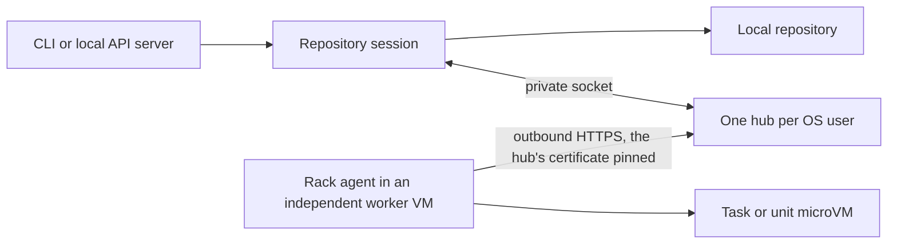

# Local rack delegation

Design of record for [#863](https://github.com/elaraai/east-workspace/issues/863),
with its follow-ons: a rack that scales as a local run does
([#1634](https://github.com/elaraai/east-workspace/issues/1634)), tasks that
declare an environment
([#1633](https://github.com/elaraai/east-workspace/issues/1633)), and ad-hoc
runs and function calls from the CLI
([#1627](https://github.com/elaraai/east-workspace/issues/1627)).
The [reconciliation](e3-rack-reconciliation.md) links all ten children and
records how current workspace and e3-cloud main change the original design.
The [setup guide](../packages/e3-rack/README.md) contains runnable commands.

## Goals and non-goals

Delegate expensive task bodies from a local repository, those of stock
runtimes and those that declare an environment of their own, and the CLI's
function calls, preserve ordinary e3 cache/results/history, and share one rack
fleet across local projects. Keep planning, repository ownership and local
fallback on the developer machine. Defer `tools` and `image` environments,
environments from a Windows launching machine, a local API server's function
calls, split calls, automatic reattachment after hub restart and embedded UI
integration.

## Topology



The rack initiates every request. The developer machine must remain reachable
for lease polling, object transfer, logs and completion, usually through an SSH
reverse tunnel to a relay: the hub listens on the loopback, and nothing
connects into the developer machine directly. No cloud account or
cloud control plane participates in a local lease. Separate agents occupy
independent worker VMs, with separate identities, encrypted source configuration
and host-enforced resource allocations. Their number and whole-GPU assignments
are mutable through the host lifecycle. There is no cross-agent task scheduler.
The companion managed runtime supports up to 32 mutually trusted sources per
agent. A worker is the trust boundary: sources that do not trust each other,
such as two clients' environments, or a cloud deployment and developer hubs,
need separate worker VMs.

## Package layout

`@elaraai/e3-rack` owns protocol, identity, registry, leases, routes, hub,
client, routing and runner adapters. Its root exports the public local APIs;
`./protocol` exports shared wire types; `./server` exports shared control-plane
mechanisms without local hub/filesystem/runner adapters; `./testing` exports the real-runner
test agent and contract suites; `./hub-main` starts the hub process. Core only
knows the optional task-body and detached-call hooks; it has no dependency on
rack code.

The API server consumes an injected dataflow runner factory. `--rack` loads
the optional package at runtime. Its optional peer creates a pnpm scheduling
cycle, although the server has no build-time rack import: build scripts first
compile the server's dependencies excluding rack, then build the full graph.

## Wire protocol

Typed control and rack requests are BEAST2, and a success is the BEAST2 of the
route's own response type, with no envelope. No reply holds a type of e3's
HTTP API: its error variant changes between releases, a rack serves the hubs
of several, a hub the e3 of several projects, and BEAST2 reads a blob only as
the type its header names, so an envelope made every reply unreadable across
releases. A refusal of the rack machine protocol is a status, which says
whether the same request is worth sending again, and JSON
(`{ error: { code, message, retryAfterMs? } }`); the hub's control socket and
a session's data socket refuse with a status and plain text.

The rack machine protocol is numbered (`RACK_PROTOCOL`, 3). Every request
names it in `x-e3-rack-protocol`; one that names another, or none, is answered
426 before its body is read, the hub's log names its rack once, and
`e3 rack list` shows why it cannot be used. `GET /api/rack/hello` answers the
protocol, the e3 release and the source's limits in JSON before any
credential, so an agent of any protocol reads it and spends no enrollment
token on a source it cannot speak to. The BEAST2 structs are fixed at a
protocol; what grows is JSON text inside them, read for the fields a build
knows: a heartbeat's `report` (features, target platform, resources and what
is free) and a poll's `offer` (what the poll may be answered with).

A lease's event carries what it asks of a rack (`resources`: its kind, a
unit's or a task's, its cores, its cap in bytes, what it reserves, and whether
it takes a GPU), which the launching machine computes: a unit reserves what its
stage measured, or e3-core's estimate, and is capped by e3-core's own rule
(`unitCap`); a task reserves its cap, from its rule's size and memory limit.
A rack books what its leases reserve, as the local budget does, lets each
grow to its cap, and guards its host's memory as the local guard does: when
the host runs short it stops the newest work it holds (`requeued-pressure`).
A rack is granted only work whose cap all its memory holds. The shared routes
answer a poll with the first lease, in the queue's fair order, that the poll's
offer holds by what it reserves; one it does not hold is
passed over for ten seconds and then holds the line at that rack, as a unit
that does not fit the local budget does there, unless the rack could never
hold it (`canEverHold`: the hub knows each rack's whole resources from its
report). An idle poll says what the oldest such lease asks
(`x-e3-rack-waiting`).

Streamed object bodies are raw bytes. Existing `eventJson` and `resultJson`
remain JSON strings for compatibility with the pinned cloud agent; replacing
them requires a negotiated protocol change, not silently changing the decoder.
The event is the current v2 task/unit envelope, including the unit's `merge`
and `own`, input closure, e3 version, launch identity and timeout; a function
call's is the `run-detached` event (below).

The hello also lists what the source takes beyond the protocol (`features`). A
source that names `call-value-objects` takes a call's value as the object its
lease's completion commits, named by hash (`RackFunctionResult.valueHash`); an
agent sends a value that way to no other source.

Output declaration names hash and length; the response is `held` or a PUT
target with headers. A successful PUT returns an opaque receipt in
`x-amz-version-id`, as the current agent uploader requires. Commit validates
receipt, declaration, hash and length while the lease is held. Success verifies
and re-references the complete output graph before writing a terminal record.

## Hub

The hub owns a private home, control socket/Windows pipe, ownership lock,
configuration, fleet and in-memory queue. Lock publication and stale-owner
recovery elect one process, including simultaneous startup. Default binding is
off; the operator configures a listener, which serves TLS unless configured
otherwise. Idle exit can be disabled with zero minutes.

The listener's certificate is the hub's own: a self-signed ECDSA P-256
certificate made the first time it serves TLS, kept in the hub's private home
and replaced only when an operator removes it. A rack trusts it by its SHA-256
fingerprint, which enrollment prints, not by a name or an authority: the rack
reaches the hub at a relay's or tunnel's address, never the hub's own, so TLS
runs end to end through whatever carries it. The advertised origin
(`--advertise-url`), when set, is the origin of every rack and data URL the hub
hands out; without it, the origin each rack request named. Plain HTTP is served
only on the loopback or a private address, to the addresses `--allow` names, as
for a TLS terminator in front of the hub: a listener that breaks these rules is
refused when saved, and a saved one is kept down with the reason.

Control routes cover handshake, sessions, lease subscription/cancellation,
ordered events, capacity/status, config, enrollment, removal, boot approval,
drain and stop. The capacity snapshot gives, of a rack that admits by its
resources, all it has and what is free: the less of what its last heartbeat
reported and what the hub's own claimed leases leave of all it has, since a
report lags a grant by up to a heartbeat and a rack may serve other sources.
A rack that reports none admits by its slots (`capacity`, `busy`). A rack says
what it is and has with each heartbeat, and the hub keeps it in memory: the
snapshot says of each rack whether this hub has heard it (`reported`), so a
rack a hub that has just started knows only from its registry is not taken
for one that admits by its slots. Sessions register canonical repository paths, their exact e3
release, process identity and private data endpoints. The hub derives opaque
repository aliases but never opens a repository or interprets its objects.

Dispatch fairly interleaves session owners. Identical task/input work in the
same canonical repository and release shares one lease; a call's lease is
never joined to another, since two calls of one program differ only in their
arguments, and its claim names no attempt and writes no log line. A late subscriber
receives its current claim. A live compatible session takes over repository
operations when an owner departs. Per-lease fences cover attempt transitions,
commits, cancellation and logs; registration fences cover heartbeat/removal
and boot approval. Shared registration patches also use the registry's atomic
`compareAndSetRack`, so distributed control planes preserve concurrent changes
and never recreate a revoked identity. Its contract suite covers every backend;
no wire or file schema changes. v2 completion lacks an attempt identity, so a prior
claimant cannot reclaim the same lease and ambiguously complete a new attempt.

The storage bridge proxies streams through a live session. Capabilities are
bound to the repository alias, lease and attempt, restricted to the admitted
closure or declared outputs, expire after fifteen minutes, and are revoked on
lease termination or reclaim. A transfer may take the rest of its capability's
lifetime. Every transfer streams through the launching process, so the hub
serves one rack `limits.transfersAtOnce` (32) at once, counted from the request
to the last byte of its stream, and answers one more `429 busy` with
`retryAfterMs` before it reads it. An object a storage request asks for is
read from the session and sent inline in the reply when it is at most the size
the request names (`x-e3-rack-inline-max`, at most 64 KiB; 4 KiB for a request
that names none) and the reply has room (2 MiB of inline bytes a reply), else
as a capability URL: the hello names `inline-objects`. A read honours `Range: bytes=N-` with `206`,
read by range from the store, so a transfer cut short is taken up from the byte
it reached; a capability that ended is minted again by the next storage request
for the same lease and object. A transfer whose rack went away, or whose
capability ended under it, is not the hub's failure (`410` to a rack still
there). The listener keeps an idle connection 75 s (Node's default is 5 s) and
says so in `Keep-Alive`, and an agent closes one idle for 60 s: Node's client
applies a server's hint only when its own timeout is set, and without it reuses
a connection the hub has just closed, whose close is still on its way over a
slow link, which ends as `socket hang up`. Reproduced over a link with 300 ms
of delay: a request on a connection idle 5.6 to 5.9 s fails, one idle less or
more does not. Uploads use distinct temporary files per PUT: an old request's cleanup
cannot remove a successor's acknowledged upload. Acknowledged metadata survives
session takeover; lease cleanup removes staging without removing committed
objects. Staging GC collects orphaned files after crashes.

## Client

`connectHub` probes a fixed handshake, starts a detached process when absent,
and requires the supported control protocol exactly. Older hubs are asked to
drain; newer protocols are refused. A hub that does not answer an ask in time
is asked again until the deadline; the error then says what it last said of
itself, and that it has stopped answering when an ask given its whole second
went unanswered. A session's capacity refresh is shared by the callers that
ask together, so a stage's units that wait for a rack ask the hub once between
them. `RackSession` owns registration, the data
socket, event polling, capacity snapshots, subscriptions and log tees. Requests
have finite deadlines and abort on close/loss. A lost hub causes local fallback,
not silent reattachment to a new process mid-run.

## Routing

Policy is repository state at `rack/policy.beast2`. CLI overrides select whether
to attach; enabled is false by default. First matching whole-name glob wins.
Unmatched tasks stay local in opt-in mode; auto mode selects eligible tasks.
A rule's size is a shorthand for cores and memory (`RACK_SIZES`, public, since
the launching machine computes what a lease asks of a rack). Its `memoryLimit`
is a ceiling, in bytes, on what one piece of its work may be capped at, never a
request, and its `gpu` asks for a rack's GPU. Both came with the local
repository's first upgrade step of its own (`rack-policy-limits`, in e3-core,
with both forms frozen there), which carries a policy an earlier release stored
into the form with them when the repository is opened.

A rule's `merges`, else the policy's `defaultMerges`, says where the merge
units of a split task it sends to a rack run: `rack`, the default, as its
pieces do, or `local`. A merge unit is a set's or a dict's merge over a key
range, or a step of a fold's combine; an array's concatenation and every
output's final assembly are no unit, and run here always. A merge kept local
is judged before the task's verdict, which its pieces share
(`merges-local`), and runs through the ordinary local body under the run's
budget and guard. It fetches nothing: every piece's output is verified into
this store as its lease ends. It is not the default, since a merge on a rack
uses the rack's cores and memory, which a wide fan-in or a large range may
need, and the upgrade keeps every repository placing as it did. A merge kept
local is no rack's work: rack-only, which keeps a rack's work for a rack,
leaves it here, and `selected` (a command's `--rack`) takes it from the
rule as it takes the rule's size. A merge kept local is never weighed for
what it would fetch (the policy's `weighFetch`), since it is judged here
first; a merge on a rack is weighed as any unit is. Both came with the local
repository's third step (`rack-policy-merges`), which carries the form the
second (`rack-policy-weigh-fetch`) writes into this one, every merge on a
rack.

Eligibility checks task name/selection, the environment's kind, the
runtime/platform configuration, East body and every executable program
(including dict merge and fold combine). It does not depend on a map unit
running first. Custom commands, a platform package named by a task that
declares no environment, and unscannable bodies remain local. The host guard
rejects file, environment and network dependencies unless deliberately
overridden per rule. Images are node, py, py-datascience, c and full; claims
also enforce health, approval and the lease's bundled-e3 version floor.

A task's tier is its runner's (`east-node` → `node`, `east-c` → `c`,
`east-py` → `py`), `py-datascience` when its platforms name
`east-py-datascience` or the environment it declares installs that platform or
torch, which that image alone holds, and `py-datascience` when its rule asks
for a GPU, the tier a rack gives its GPU to (`rackTierFor`, which takes what
the environment installs). What an environment installs is read from its lock
as its sync takes it (`@elaraai/e3`'s `pythonInstalls`): a member's
dependencies and what is required beside it, or a project's own packages with
their default groups, which its `pyproject.toml` says, and no extra nothing
asks for. It is read only for work the slim image would otherwise take, once
for each environment in a run. So a project platform package that asks for
`elaraai-east-py-datascience[torch]` puts its task over the image that holds
the platform and torch, and an environment built over it leaves them to the
image, whatever platforms the runner names. Such work takes a GPU only when
its rule asks for one (its lease's `resources.gpu`). It never falls back to
`py`, which would send torch with the environment: work no rack of its tier
takes runs here (`no-rack-for-tier:py-datascience`). Only an `east-py` task
may ask for a GPU (`gpu-not-east-py` otherwise); with no GPU on any rack the
task runs locally (`no-rack-holds:gpu`).

## Environments

A task that declares a `python`, `node` or `workspace_node` environment, and
with it the project platform packages its runner names, runs on a rack that
composes environments. No container runtime takes part, on any machine: the
launching machine installs the environment a second time, for the rack's
platform, with the frozen installs a local run uses; packs it as layers; and
the hub serves them to the rack as it serves task objects.

**The build (e3-core).** `materializeEnvironmentFor` installs an environment
for a platform that is not this machine's, in a directory its caller names:
wheels only (`--python-platform`, `--no-build`), the project's own packages
built to wheels here and refused unless pure, npm and pnpm asked for the
platform's packages, and no install script run. A python environment carries
the platform's build of the Python its virtualenv was made with
(`.python/`, reached by a relative link), so it is whole wherever its tree is
put: a tier supplies the operating system and, on the GPU tier, the device and
its driver. What no install makes for another platform is refused by name
(`EnvironmentTargetRefused`), never compiled.

**Layers (e3-core, `storage/local/environment-layers.ts`).** The tree is
packed as gzip tar layers, each entry under `var/task/.e3-env/`, where a guest
finds a composed environment: the interpreter; what the lock installs, a
gigabyte of files a layer, in sorted order; and what the project's own
packages installed. The same files pack to the same bytes (entries sorted,
times and owners zeroed, two modes, one gzip setting), so an environment whose
lock did not change shares its interpreter and package layers with the one
before it, and a change to the project's code makes one small layer. Entries
are plain: files, directories, and links, each link packed as the path from it
to what it leads to (its `..` segments all leading, no `.` and no empty
segment, never above the environment); a link that leads out of the tree, or
anything else, refuses the pack. A layer is composed where it runs by
`unpackEnvironmentLayer` (e3-core, `environment-layer-unpack.ts`), which any
rack agent shares: it takes such links alone, and writes nothing through a
link, one its layer made or an earlier layer did, so a layer another machine
sent writes nothing outside its root. They are kept beside the repository,
not in its object store:

```
<repo>/rack/env-layers/
  blobs/sha256-<hex>                                 each layer once
  manifests/<envHash>-<e3 release>-<platform>.json   the EnvLayerManifest
  building/                                          a build's claim and scratch tree
```

One build runs at a time for a manifest, in a repository: a second run that
needs it, in this process or another, waits for the first. `e3 repo gc`
removes a manifest whose environment spec nothing reaches, each layer no kept
manifest names, and a dead build's leavings (a claim whose builder is gone, or
that named none for ten seconds, its scratch tree, and a manifest's staging
file once no build runs), as it sweeps `<repo>/envs`. A run that is stopped
stops waiting for another's build. The
packer is e3-core's because the rack package holds no tar library; what a
manifest says is the rack package's (`EnvLayerManifest`, as a deployment
publishes one: `baseTier` the lease's tier, `baseImage` `rack-tier:<tier>`,
since it was built from no image).

**The launching side (`runner/rack-body.ts`, `runner/environment.ts`).** Before
it creates a lease that names an environment, the body makes sure the
repository keeps the layers for the platform of each rack that could take the
work (`publishEnvLayers`), once for an environment and a platform in a run,
and tells its caller (`onEnvironment`: `building`, `built`), which the CLI
prints as `[ENV]` lines. A run whose repository keeps them prints neither. The
lease names the environment (`RackLeaseEvent.environment`), and its closure
holds the environment's spec and files, as it always did.

**Serving.** The session's data server gains two reads under its own
credential: a manifest by its name, and a layer, from a byte on, only when the
manifest asked with names it. The hub's bridge reads the manifest through the
lease's session (`readEnvManifest`: a lease reads its own environment's) and
issues a capability for a layer, bound to the lease and its attempt as an
object's is, served with the same bound and ranges (`presignEnvLayer`). The
hub's `EnvIndexStore` keeps nothing: it asks the lease's session for the
manifest built with the lease's e3 release for the claiming rack's platform.
The shared route reads the manifest for the release the lease names. `submit`
takes a lease that names an environment, and `canClaim` grants it only to a
rack that reports `environments` and whose `target` is a platform the session
keeps the layers for: another rack is never granted it.

**The rack.** A rack that composes environments says so in its report, with
the platform it runs them on. For a lease that names one it asks
`/api/rack/storage` for the manifest and its layers, composes them over the
tier's image for that lease, and its guest names the composed tree in
`E3_BAKED_ENV_HASH` and `E3_BAKED_ENV_DIR`; e3-core links `<repo>/envs/<hash>`
to it (`prebuiltEnvironment`, `linkPrebuiltEnvironment`) and installs nothing.
One it cannot compose ends its lease `environment-failed`, and the work runs
locally.

**Over a tier.** A rack that composes environments built over its tier says
`environments-over-tier`, and reports the manifest of each tier image it
boots them over. The launching machine then builds a python environment over
that image, and the rack is served those layers: see
[`e3-environment-over-tier.md`](e3-environment-over-tier.md).

| The task | Reason on its `[LOCAL]` line |
| --- | --- |
| Declares a `tools` or an `image` environment | `environment:tools`, `environment:image` |
| Launching machine is Windows | `environment:windows-host` |
| No healthy rack of its tier composes environments | `no-rack-for-environment:<tier>` |
| A dependency has no wheel for the rack's platform | `environment:no-wheel:<package>` |
| A project package holds native code | `environment:native-package:<package>` |
| A pnpm lock, where pnpm installs for its own platform alone | `environment:pnpm` |
| The build fails | `environment:build-failed`, the tool's words in the task's log |
| Names a platform package and declares no environment | `non-stock-platform:<name>` |

## Execution semantics

Core probes the cache before the body hook. The hook takes no local budget
grant; its local continuation preserves all existing process settings and
budget. The orchestrator's width includes the compatible racks' cores (a
slot-based rack's slots). The body leases a unit only to a rack that caps it at
what its lease asks (`rackCapsUnits`: one that admits by its resources); any
other unit runs here, under the run's own budget and guard
(`no-rack-caps-units:<tier>` where the racks of its tier cap none). The hub
grants by the same rule (`rackEverHolds`, which the body's `rackCouldHold`
reads too): a rack that reports no resources, or that this hub has not heard
report, is never granted a unit, whatever its poll offers, so in a fleet of
both kinds no unit reaches a rack that caps nothing; and a unit's lease must
name what it asks. So a unit always runs where something stops it when it
outgrows its share. The body says so of itself (`TaskBodyExecutor.stopsUnits`),
whatever racks there are: e3-core reads it from the body it is given, so no
host has to say it in step, and starts a split task's stages with every unit
at once under a guarded budget, as it does with no body. The choice reads no
snapshot, so none can go stale: a dataflow fixes it as it starts, and a rack
that turns healthy later changes nothing. A rack that admits by its slots caps
nothing, and is leased whole tasks alone; a run's description of its racks
says so of one (`whole tasks only`). What a rack is to a piece of work is one
rule in the body (its `standing`: it takes the work, it has said it never
does, or it has not said what it is), which both the fleet a lease is made
for and the reason there is none are read from. A lease that ends `outgrew-cap` is a
unit's requeue: the body tells the run (`onRequeued`, reason `cap`), the
session records the stopped attempt `interrupted`, with the local run's log
line, and the next lease asks `unitCap` of the cap it reached, reserving that
cap; past its rule's limit, or every rack's memory, the unit runs locally. A
lease that ends `requeued-pressure` is a unit the rack's guard stopped: the
body tells the run (`onRequeued`, reason `budget`), the session records the
attempt `interrupted`, and the next lease reserves what the unit reached, at
least what it reserved, as the local guard's requeue does. A whole task its cap
stopped fails (`memory-limit-exceeded`), as a task the local guard stops does.
A first run's unit, whose expectation is e3-core's estimate (the runner's own
memory and what the largest piece holds of its rows), reserves the estimate
and is capped at `unitCap` of it, as a measured one is: locally that estimate
is the unit's reservation, so a first run on a rack is as wide as one locally.
A local unit on an estimate has no cap of its own and is stopped only when the
whole budget is passed; a rack's unit is its VM, which may grow to its cap and
no further, so one the estimate is low for is stopped at its cap and leased
again under a larger one.
Only a unit that expects nothing books its rule's limit, else its size's
memory. The racks are full when no compatible rack's free
resources hold the lease, less the work already queued; work no rack could
ever hold is not queued, and runs locally. Split-task
planning and final assembly stay local; both pieces and merge bodies delegate,
unless the rule's `merges`, else the policy's `defaultMerges`, keeps merges
local.
Each unit's lease names the split task's execution it runs in, its scope
(e3-core's `SplitScope`: a random id, and whether a later unit reads what it
writes). The hub grants it with the lease only to a rack whose report names
`split-scopes`, which may keep what the scope's leases wrote for the later
ones, so a merge reads its pieces where they were made rather than over the
link; every output still comes back whole before its unit succeeds. As the
execution ends, however it ends, its session ends the scope (control route
`/v1/sessions/:id/scopes/end`, hub protocol 6), and a session that closes ends
all of its scopes; each rack granted a lease of one is told with its next
heartbeat (`x-e3-rack-scopes-ended`). The hub notes which rack each
completed lease of a scope that feeds it wrote its output and targets on
(`ScopeWrites`, bounded at 200,000 objects, let go as the scope ends), and a
lease of a scope waits up to `SCOPE_AFFINITY_MS` for a rack that wrote some
of what it reads before another may take it — only for one that could be
granted it (its tier, what its resources could ever hold, its approval and
release, the work's environment), never for one that could not; `fetch-costs`,
asked with the scope, counts those objects held there.

The policy's `keep` widens the scope: `split` (the default) is the above;
`session` names one scope, the session's own (`RackSession.sessionScope`), on
every task's and unit's lease of the rack session — one `e3 dataflow run`, or
one `e3 watch --start --rack` across its re-runs — feeding it but for a piece
whose merges run here. A task's output a rack made is then read there by the
session's later work, which goes to it input by input, not pile onto one
rack. No split task's end ends it; the hub ends it as the session ends:
closed, or swept as gone or silent. It keeps a task's data on a rack until
then, or an hour unused, within the rack's bound. It came with the local
repository's fourth step (`rack-policy-keep`), which carries the merges
step's form into this one, kept for a split task alone.

| Outcome | Record and action |
| --- | --- |
| Cache hit | Return the cached result; no lease. |
| Ineligible or no compatible rack | Use the ordinary local body: at once, or, under rack-only, once a rack that runs the tier has stayed unhealthy for two minutes (`source-unreachable`). |
| A unit, and no rack of its tier caps one | Use the ordinary local body at once (`no-rack-caps-units:<tier>`): a rack has said what it does, and is not waited for. |
| A unit, or work that declares an environment, and a rack of its tier the hub has not heard report | As for a rack that is not healthy (`source-unreachable`): at once, or, under rack-only, once the rack has stayed unheard for two minutes. Its next heartbeat says what it is. |
| A queued lease, and the hub does not answer an ask for the fleet | The lease stands on the snapshot its events keep: an ask that fails is no verdict on it, and a hub that is gone ends it by its events. |
| Capacity full | Spill when enabled and local cores/memory are available; otherwise wait. Dedupe attachment precedes spill. |
| Claim | Mint a new attempt; write hub owner before running, then persisted placement log and claim event. |
| Success | Verify whole output, flush logs, record success, publish completion. |
| Task failure (including signal exit) | Record failed and return the verdict; retry locally only if explicitly configured. |
| Infrastructure failure or lost lease | End the rack attempt and run locally with a fresh execution identity. Under rack-only, work whose transfer failed its tries is leased once more first. |
| A unit its cap stopped | Lease it again under a cap half as large again; past its rule's limit or every rack's memory, run it locally. |
| A unit the rack stopped for its host's memory | Lease it again reserving what it reached (`requeued`, reason `budget`); past its rule's limit or every rack's memory, run it locally. |
| A task its cap stopped | Record failed (`memory-limit-exceeded`); retry locally only if explicitly configured. |
| Timeout | Record an error; no local retry. The host also enforces the deadline. |
| One subscriber cancels | Detach it and record its cancellation; preserve shared work. |
| Last subscriber cancels | Cancel lease, notify the agent's cancellation watch, record cancelled; no local retry. |
| Hub dies | Local fallback; existing owner liveness rules identify the dead hub's attempt. |

A lease's result gives its `reason` when it did not succeed: a code and what
it carries (`protocol/task-envelope.ts`: `outgrew-cap`, `memory-limit-exceeded`,
`input-transfer-failed`, `output-transfer-failed`, `source-unreachable`,
`guest-crashed`, `guest-boot-failed`, `tier-image-failed`, `environment-failed`, `work-disk-full`, `no-room`,
`rack-stopping`, `rack-failed`, `requeued-pressure`, `task-error`), read for the fields a build
knows, and a code it does not know is a rack's fault it cannot name. It also
lists the tries of its transfers that were followed by another. The body places
the work by the reason, a placement event carries it (`kind`, `detail`), a run
prints each on its line and its summary as it ends, and the hub keeps how its
last twenty leases ended for `e3 rack status`.

Results retain the usual execution identity, unit flag, output, peak memory and
history shape. Placement never enters cache keys. API dataflow factories receive
the server's existing storage and shared budget, close their session after
success/failure/cancellation or failed start, and leave calls/mutations local.

## Ad-hoc runs and function calls from the CLI

`e3 run --rack` and `e3 call --rack` open a session for the one piece of work
they name (`OpenRackRunnerOptions.selected`): the flag selects it, whatever the
policy's rules or its `enabled` switch say, and a rule that matches its name
still gives its size, timeout, memory limit, GPU and host-access override. A
call is named `fn:<name>`, as its lease names it; an IR file's call by the
file's name without its extension. Fitness still applies, and the command
prints every reason its work runs here. A server's URL is refused either flag:
a server decides where its own work runs.

`e3 run --rack` runs the task through the session's runner, as a dataflow
runs its tasks: a whole task's body is leased, and a split task's pieces and
merges are, its planning and assembly staying here. It ends with the rack
summary a dataflow run ends with, which says where a split task's pieces ran.
Ctrl-C leaves its leases, from before the session opens, and their racks are
told to stop the work.

An ad-hoc run's files stay its user's. A value input is stored as a copy
(`objectAdoptFile` with `link: false`), never as the file itself by a hard
link, so a file written again between runs leaves the stored object its
bytes. Its `-o`, like `e3 call -o` and `e3 convert -o`, is replaced and never
written into (`writeOutputFile`): a path that names an earlier delivery, which
a store may hold as an object, keeps that object whole.

A call is a `run-detached` lease (`createRackCall`, beside `createRackBody`;
`openRackRunner` gives e3-core's runner both). e3-core hands a detached call to
its hook (`LocalTaskRunnerOptions.detached`) before any scratch directory or
budget grant is taken; the hook's `local` continuation runs it here with the
runner's budget and process settings, as a call with no hook runs. The two
executors share what is not their own (`runner/rack-lease.ts`): work is
admitted by one rule (`admitWork`), placed and queued through the fleet as it
sees it (`RackFleet`), waited on (`awaitLease`) and reported
(`RackPlacementReport`) the same way, and a rack's fault is worded once
(`fallbackReason`). Each keeps what its work's end comes to: a task's records
and logs, or a call's value and deadline.

- **Fitness**: the runner's tier, the environment it declares, judged as a
  task's is, and its program, scanned for platform calls that reach the host
  by the scanner tasks use.
- **The program** is an object of the repository, named by hash in the lease
  and staged with its closure; a value argument past what a lease carries
  inline (`RACK_INLINE_ARGS_MAX`, 192 KiB between them) is stored as an object
  and staged as a dataset argument is. The caller holds the repository's
  running work while the call runs, so no sweep takes them.
- **Its lease** is sized as a whole task's is (`wholeResources`), from its
  rule's size or the policy's default.
- **Its time** is its rule's timeout, when a rule that matches its name sets
  one, longer or shorter than its caller's; else its caller's own (the CLI
  gives a call ten minutes). It is counted from when its lease is first
  queued, on the host's clock; a call that falls back to run here runs with
  the time left, and one that is never leased with the same time.
- **Its value** returns inline up to `RACK_INLINE_VALUE_MAX` (192 KiB); a
  larger one is committed as the lease's output and named by hash, to a source
  that takes one (above). The shared routes take a hash only as the output a
  successful completion commits, from a source that takes one.

| The call | What it comes to |
| --- | --- |
| Not fit for a rack, or no healthy rack of its tier | Runs here; its line says why |
| No rack claims it within the claim timeout | Runs here; under rack-only, waits while a compatible rack is healthy |
| Success | The value, inline or read from the object its completion names |
| `too_large`, `timed_out` | Its answer, as a local call's would be |
| The function fails on the rack | Its answer, with its exit code and log tails; run again here only where the policy retries failures locally |
| Its cap stops it | Fails, `memory-limit-exceeded`, naming the cap and the rack |
| The rack cannot relay its value (`rackResultTooLarge`) | Runs here (`fallback:value-too-large-to-relay`) |
| The hub or the lease is lost, or the rack's infrastructure fails | Runs here, with the time left |
| An outcome with a reason of the rack's own (any but `task-error`) | Runs here: the reason is the rack's fault, whatever outcome came with it |
| Ctrl-C | The lease is left, its rack told to stop it; ends as an aborted local call. Before a lease is made, nothing starts here either |

## Versions and persisted forms

The protocol golden fixtures were generated from e3-cloud's rack protocol; rack
protocol 3 changed two of them, the lease request and the heartbeat, by one
field of JSON text each.
Agents advertise `+e3.<release>`; bundled e3 must meet the project's floor. Local control protocol is
4 exactly (a call's claim, which names no attempt, made the `claimed` event's
attempt optional); no numeric greater-than compatibility assumption is made for
positional BEAST2 structs. A hub whose hello does not read at all is one from
before replies lost their envelope: it is asked to drain, as an older one is.

Task/package/repository object and execution schemas do not change. The
policy is repository state, and an incompatible change to it ships a repository
upgrade step, as the rule's `memoryLimit` and `gpu` did. The layers a
repository keeps of an environment (`rack/env-layers`) are what a build made
and can make again: each manifest names the e3 release that built it, in its
name and in itself, a release reads only its own, and gc removes what nothing
needs. Hub files are outside repositories: a stable envelope stores release,
format (initially 1) and encoded payload. Unknown formats fail explicitly; a
future change must migrate or refuse them before decoding. The hub's TLS
certificate and key are such a file (`hub-tls.beast2`), private like its
identity. Session upload metadata and locks are transient host state, not
portable package objects.

## Security

Private home/socket permissions isolate local controls by OS user. Enrollment
tokens are single-use and expire; machine credentials are hashed at rest,
rotate with overlap and are revoked by removing the registration. An optional
IP allowlist narrows the listener, and is required for plain HTTP. A rack sees
only its lease's input closure and declared output targets, not arbitrary
repository objects or local paths. Anything on a plain-HTTP path reads every
token, data URL and object on it, and a VPN whose hub decrypts and re-encrypts
traffic is such a path: plain HTTP is for a terminator in front of the hub, or a
path encrypted end to end, such as an SSH tunnel.

The hub keeps no task data: leases and capabilities live in memory, and objects
stream through it from the owning session. What a worker keeps between tasks is
the worker's policy; the hub works unchanged with an agent that fetches every
object for each task and keeps nothing after it.

The local `enroll` command prints the source origin, the certificate
fingerprint, the matching release and a short-lived token separately. The
companion's worker-local `configure` and `enroll` take source information,
pins and secrets through hidden terminal prompts, then persist them encrypted.
A plain-HTTP source is an explicit worker opt-in, subject to host endpoint
policy. No printed worker command contains a token or
source address. A new registration is observable before the worker starts;
enrollment, service activation and capacity admission are distinct stages.
Worker provisioning and the final source/lifecycle CLI remain companion work.

## Testing

`TestRackAgent` speaks the real wire, stages the input closure, executes stock
e3-core runners and uploads every written object. It runs a call's lease with
e3-core's `runDetached` over the closure it fetched, and completes it with the
value inline, or, to a source that takes one, as the object it stages. It reports that it composes
environments for the platform of the machine it runs on, and for a lease that
names one it fetches the layers, checks each against its digest and size,
unpacks them, and links the tree as the pre-built environment. Protocol fixtures validate
current-cloud encoding independently. Contract tests cover identity, stores,
leases, transfer receipts/retries, revocation, lost leases, takeover, cancellation
and cache/hash parity. CLI and local API tests exercise the complete attachment
path. Browser/API portability and absence of the optional peer have separate
tests. These are not evidence of KVM or deployed-rack acceptance.

## Relationship to e3-cloud and open items

The package exposes cloud-compatible shared seams without importing or changing
the closed repository. Cloud may adopt those seams in its own change. The
current agent protocol can serve the local hub. Companion PR #254 implements
request deadlines, durable completion retries, lockstep releases and encrypted
worker enrollment. The local handoff follows its prepared-worker commands,
and ready heartbeats activate capacity after pending-completion restoration and
managed resume. Enrollment still advertises zero capacity. Capacity counts free
plus occupied slots while ready and becomes zero during drain/stop; existing
work may finish. Only heartbeats refresh the 45-second readiness window. Source
boot approval remains an additional gate. Local registration fences and cloud
conditional writes preserve concurrent updates and revocation.
Named host/source management, service/network activation and host resource
admission remain cloud #253 work. Advertised capacity is not permission to
remove quarantine or start an unqualified worker.
Cloud #195's real-agent/hardware acceptance remains distinct from the test agent.
See the reconciliation for the status of every companion and deferred feature.
