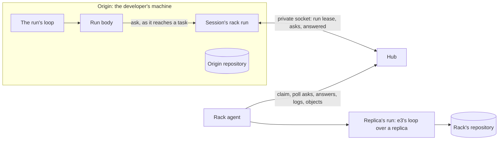
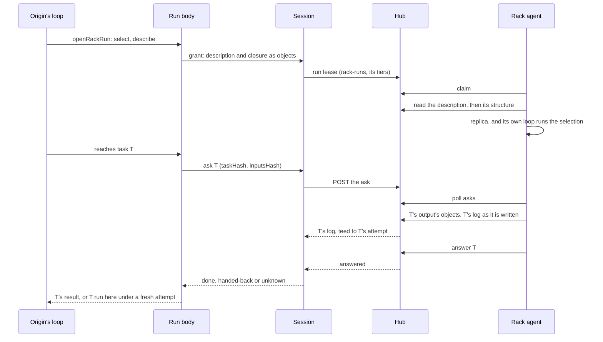

# e3 sync, and a rack's run

Design of record for a rack that runs part of a dataflow run whole, as one
lease, rather than a lease a task: the sync layer it is built on
([#1800](https://github.com/elaraai/east-workspace/pull/1800)), what the
dataflow loop takes from a runner for it
([#1801](https://github.com/elaraai/east-workspace/pull/1801)), both sides of
the run in one process
([#1802](https://github.com/elaraai/east-workspace/pull/1802)), and the same
through a hub ([#1803](https://github.com/elaraai/east-workspace/pull/1803)).
It extends [local rack delegation](e3-rack-delegation.md), whose terms it
uses.

## Goals and non-goals

A rack that is handed a task at a time pays, for every task, a lease, a
claim, a fetch of its inputs and a transfer of its output; and a split task's
units each pay the same. Where a rack can run a stretch of a run whole, the
origin should hand it the stretch once and take each result as its own loop
reaches the task, with the cache, the history and the logs as a local run
leaves them.

- **Kept:** the origin owns the run. Its loop orders every task, records every
  attempt, writes every output ref, and runs here whatever the rack does not
  answer. Task and cache identities never change with where work runs.
- **Kept:** at the origin a run reads as any run does: each task's status in
  the run's output, and what it printed on the rack in `e3 task logs`.
- **Built:** a part of a workspace described, and made a replica of in another
  repository, whose store reads through to the origin; a replica's run, which
  runs the part with e3's own loop and answers for each task; the origin's
  side, which grants the part before its loop starts; and both over a hub.
- **Not built:** whole-workspace sync, binds and records in a selection, a
  mirror kept up to date, an offline replica, and any agent but the test agent
  that hosts runs (see [open items](#open-items)).

## Topology

One run, as it goes:

## Terms

- **Selection** (`SyncSelectionType`): the whole workspace, or part of it by
  tasks, binds and records. Only tasks are supported in a part.
- **Cut** (`selectionCut`): the package holding only the selection's tasks, by
  the hashes the origin's package names them by, with its whole structure and
  no refs, functions, records or sources.
- **Edge:** every keypath a task of the cut reads that none of its tasks
  writes. A replica takes its edge for root inputs.
- **Description** (`SyncDescriptionType`): the release that wrote it, the
  origin's package, the cut as a value, the edge's refs, and executions.
- **Replica:** a workspace made from a description in another repository.
- **Origin:** the repository a description was made from.
- **Rack's run:** a replica's run, granted a selection by the origin and asked
  task by task.

## The sync layer

`e3-core/src/sync`. Nothing in it knows of racks.

### A selection and its cut

`selectionCut(pkg, graph, selection)` is pure. It refuses (`SyncSelectionError`)
a full selection, which a workspace bundle carries; binds and records; names
the package does not have; and a selection that leaves out a task between two
of its own. A task outside the cut that depends, however far back, on a task
of it, and writes what a task of it reads, would have the cut read the value
it made from the origin's inputs, not the cut's.

### A description

`syncDescribe(storage, repo, ws, selection, { values? })` describes the
selection at one moment, under running work and the workspace's `export` lock
held shared.

Each edge's ref carries the version vector the origin's loop gives it: a root
input's own entry (its value's hash, or a record's head commit), and a task
output's the root inputs it was made from. `values` gives an edge a value its
ref does not hold yet, such as the output the execution cache will answer its
task with; that value is given its task's inputs' vectors, merged.

A replica's loop seeds every root input with its own entry, so it cannot tell
that two of its inputs were made from two values of one input of the origin.
The origin's run would make the older one again first; a replica's cannot. So
a selection whose task would read such values is refused, naming the task and
the input. `descriptionRoots` lists what a description names: its tasks, its
edge's values and its executions' outputs.

### A replica

`replicaCreate(storage, repo, ws, description, origin)`:

- refuses a description a newer release wrote (`SyncReleaseError`), one that
  names no release, and one that names anything by no hash, a version vector's
  entry among them; it takes one an older release wrote;
- writes the cut as a package object, under the workspace's `deployment` lock,
  for a workspace that does not exist;
- reads the structure through to the origin: every object the roots reach that
  names others, read as gc's mark reads them, header first, so a collection's
  segments and a task's program are not read. Any object the description
  reaches that the origin leaves out is named (`SyncObjectError`);
- writes the workspace as a bundle's import does (`writeMadeWorkspace`), its
  package named at a version of its own, `<version>-replica.<hash>`, with no
  package ref: the cut is nobody's named package, and a bundle exported from a
  replica must never name it by the origin's version.

### Reading through to the origin

`withReadThrough(storage, repo, origin)` is the replica's store, its `read`,
`readRange`, `stat` and `materialize` falling back to the origin for an object
it lacks. Misses are asked for in requests of at most 256 objects, one request
in flight; each object answered is checked against its hash as the store takes
it in. So a task's run fetches what it reads, as it stages it, and nothing a
task of the selection does not read is fetched.

`originObjects(storage, repo, description)` is the origin's side, which
serves only the description's closure, worked out at the first read and again
after a read that could not. An object over 8 MiB, or past 64 MiB in one
answer, is answered as a stream read 8 MiB at a time, which the replica takes
in with `writeStream`: no read holds a large object whole.

## What the loop takes from a runner

`e3-core`'s `TaskRunner`, `TaskResult` and the loop's callbacks gained:

- **`TaskRunner.takesWhole(taskHash, { taskName })`.** A runner may run a
  split task as one execution, planned wherever it runs. The loop asks once
  for a launch, of split tasks only, never of one a stage of which was begun
  here (a resumed run's, or one a run before left rooted), and takes a runner
  that throws for no. It then calls `execute` with `TaskExecuteOptions.whole`
  set, plans nothing and records no plan. `LocalTaskRunner` asks its body
  (`TaskBodyExecutor.takesWhole`); a body that takes one is called once as the
  task, and its `local()` plans the split here.
- **`TaskResult.handedBack`.** A runner that could not run the work where it
  runs, for a reason that is not the work's, says why. The loop leaves the task
  waiting, with its dependents, and records no failure; `onTaskHandedBack`
  says it, and `e3 dataflow run` and `e3 watch` print `[BACK]`. For a split task, its
  stage decides (`SplitTask.advance`): handed back only when every unit that did
  not succeed was handed back. Its execution is left `interrupted`, its plan
  rooted for the run that takes the stage up.
- **`TaskResult.durationMs`.** How long the work took where it ran, which the
  loop records, in whole ms, in place of its own clock.
- **`TaskCompletedCallback.executionId`.** The execution that settled a task:
  the one it ran as, or the one the cache served it from.

## Predicting the cache

`dataflowPredict(storage, repo, ws, { force, filter })` says which tasks of a
run the execution cache answers, which it does not, and which wait on an input
nothing has set. A task is answered when a success exists over its inputs and
either its output ref holds that success or its latest attempt is it: the rule
on which the loop's cache check and the runner's probe agree, where either alone
would not. A task below an unanswered one is predicted over a placeholder for
the output the run will make (`dataflowResolveInputHashes`' overlay), so it is
unanswered too.

## A replica's run

`replicaRunOpen({ storage, repo, runner, origin, width })`, in `e3-core`.

- **Grant**, once: makes a replica in a workspace of its own,
  `replica-<uuid>`, and starts e3's loop over the read-through store, with what
  the grant forces. A cancel while it is being made starts no run.
- **Ask** (`taskName`, `taskHash`, `inputsHash`, `onLog`, `signal`): waits until
  the run settles the task, then answers from the execution the run settled it
  with, over the inputs asked, never from another run's in the repository:
  - `done`, with the state, the output, the exit code and the timing. A
    success's output is the origin's whole before the answer;
  - `handed-back`, with why;
  - `unknown`: waiting, skipped, never reached, over other inputs, or
    cancelled. An ask whose signal aborts answers `unknown` at once.
- **Outputs** are sent as each task completes, before anything asks: every
  object the output reaches that the origin lacks (`ReplicaRunOrigin.have`), in
  writes of at most 16 MiB, a larger object alone as a stream. Each object is
  written once at a time; an output that reaches one another output is writing
  waits on that write, and writes it again if it failed. Through a hub, a
  second write declared before the first's commit would be refused.
- **Logs** are followed by offset from the first byte of an execution this run
  started, never one a process that went away left recorded running, and from
  the answering execution's when that is known first. A read that ends at the
  live end of a log cut mid-character is read again shorter, by the store's own
  count of bytes. A log that cannot be read to its end costs the ask its log,
  not its answer.
- **Cancel** resolves once the run has ended and what it was writing to the
  origin is written, then removes the replica's workspace. What the run made
  stays in the repository, rooted by its executions.

## The origin's side

`e3-rack/src/run`.

### Selection

`rackRunSelection` grants a task when the cache does not answer it, the
policy sends it to a rack (`EligibilityEvaluator.evaluateTask`), it declares no
environment, its tier is one the rack that would take the run up boots, it is
no split task whose merges the policy keeps here, and every task it depends on
is answered or granted. Its inputs are then there before the run starts, or
made by the grant. A run whose processes are bound to this host is granted
nothing. The answered tasks' outputs are the description's `values`.

### The run body

`createRackRunBody` takes each granted task whole and its result from the
rack's run; everything else goes to the body it wraps, or `local()`.

- The origin owns the attempt: it records it running, appends the log the
  rack's run delivers, and records how it ended. A success is taken only once
  its whole output is held here (`touchReachable`), and its log ends
  `e3: on its rack: ran N ms`.
- A failure on the rack is the task's verdict, unless the policy retries
  failures here; an error whose reason begins `timed out:` is one too.
- Anything else is no verdict. The attempt is recorded `interrupted`, with a
  host code (`rack.handed_back`, `rack.unknown`, `rack.lost`,
  `rack.incomplete_output`, `rack.failed`, `rack.error`), its log keeping what
  the rack sent; the task then runs here under a fresh attempt.
- Each granted task's placement, on the rack or here, goes into the run's
  summary.

### openRackRun

Selects, describes and grants before the origin's loop starts, and returns the
runner the loop runs with and the slots the grant adds: one for each granted
task, which waits on the rack's run. With nothing selected no run is opened. A
failure on the rack's side never stops the run: the runner is then the local
one, and says why.

## Through a hub

### Wire

`HUB_PROTOCOL` 8; [WIRE_MIGRATION.md](../../../docs/conventions/WIRE_MIGRATION.md)
has the entry.

- A rack names the feature `rack-runs` in its heartbeat.
- A run lease's event is `RackRunEvent`: mode `run`, the description's object,
  what is forced, the tiers its tasks need, each task's verdict, and a time
  limit that is its tasks', one after another. Its closure is the description
  and everything it reaches.
- The hub grants a run lease only to a rack that names the feature and boots
  every tier, and mints it no attempt: the origin's run body owns each task's.
- Rack routes: `/api/rack/run/asks`, a long poll of the asks after a cursor,
  held outside the lease fence; `/api/rack/run/answers` and
  `/api/rack/run/logs`, under it, for a run lease the rack holds.
- Control: `POST /v1/sessions/:id/leases/:leaseId/asks` numbers an ask; the
  session event `answered` carries its answer.
- A task's log is teed to its asker's attempt (`/v1/logs/tee`), which writes
  it; the hub stores none of it.
- A run lease writes every output of its run, so an object's target leaves the
  lease once the object is held or committed (`LeaseStore.releaseTargets`), and
  its upload capability goes at its commit: a lease holds what it has in
  flight, never the hub's every capability.
- A hub refuses a session of protocol 7.

### The session

`sessionReplicaRun(session, ...)` is a rack's run as the origin sees it
through its session.

- Its grant writes the description and its closure as objects, queues the run
  lease, and waits for a claim within the policy's claim timeout, or until its
  caller stops; else it gives the lease up and the run runs here.
- Each ask is posted with a fresh id its task's log is teed under, and its
  answer comes as an `answered` event.
- A lease that is lost fails every ask still waiting: their tasks run here,
  their rack's run lost. A lease that ends otherwise, or a cancel here, answers
  them `unknown`.
- A run lease taken up again, by another rack or the same one, answers
  `unknown` each ask whose log a rack before had begun to tee, so its task runs
  here under a fresh attempt rather than with two racks' logs under one; every
  other unanswered ask is the next rack's.

### When a run is granted

`openRackRunner` grants a rack's run only when its caller gives the run it
runs (`run`: what it forces, and its filter). `e3 dataflow run` and
`e3 watch` give it; a command's one piece of work, and an API server's run,
whose filter it does not know, do not. It grants one only while a rack that
hosts runs has a slot free, and only the tiers of the one that boots the most,
so a run never waits on a claim that cannot come. `describe()` says how many
tasks were granted; `endRun()` ends the rack's run once its run is done, as
`e3 watch` does after each run, so it holds no rack's slot while it waits.

### The test agent

`TestRackAgent`, given `rackRuns`, hosts a run lease as an agent would: it
reads the description through the lease, makes a replica in its own store, runs
it, answers the asks it polls, posts each task's log as it is written, extends
the lease, and completes it when the run ends. An ask its run cannot answer is
answered `unknown`, never left. `runRunner` sets the runner its run's bodies
run with.

## Execution semantics

- **One result a task.** The origin's loop asks for a task only when it reaches
  it, over the inputs it found it with; the rack's answer counts only for those
  inputs. An input that changed at the origin after the grant is asked over its
  new value, which the replica does not answer, so the task runs here.
- **Every failure that is not the task's runs it here.** A hand-back, an
  unknown answer, a lost run, an incomplete output, and an error that is no
  deadline's: each leaves the attempt `interrupted` and runs the task under a
  fresh one. A failure of the task's own is its verdict, as it would be here,
  unless the policy runs a failure again here.
- **The cache holds.** What the rack made is recorded as a run here records
  it, so a plain run after it executes nothing.
- **A split task taken whole** is planned on the rack; the origin records no
  plan and plans nothing.

## Versions and persisted forms

The run lease is a wire change, hence protocol 8, under which a session of an
older release is refused. No stored form changes: a description travels as an
object of a lease's closure, which no ref names and running work keeps from gc
while the run holds it, so it needs no gc kind. A replica's workspace is an
ordinary workspace of its repository.

## Testing

- `e3-core`: `selection.spec`, `describe.spec` and `replica.spec`, a replica's
  results held to the origin's (the same task, inputs and output hashes);
  `dataflow-predict.spec`, each prediction held to what a real run then does;
  `replica-run.spec`; and the dataflow contract suite, on every backend, for a
  hand-back and a task taken whole.
- `e3-rack`: `rack-run.spec`, both loops in one process; `hub-runs.spec`, the
  wire; `session-run.spec`, over a scripted session; and `rack-run-hub.spec`,
  the run's cases through a real hub, a session and the test agent.
- `test/integration` `rack.spec`: `e3 dataflow run --rack` over a chain on a
  rack that hosts runs takes one lease, prints each task `[DONE]`, shows in
  `e3 task logs` what each printed on the rack, and a second run is all cached.

Measured: a replica of a chain asked its origin for 4 of 20 objects in 3
requests, and of its structure alone took 7 objects in 2; fifty independent
tasks ran through a hub in one lease in 2.6 s, none of them at the origin.

## Open items

- **Agents.** No production rack agent names `rack-runs` yet. The companion
  agent's support follows a release with this in it, and a measure of a rack's
  run against a lease a task on real workers.
- **A hand-back's event.** A hand-back writes no event of its own to the run's
  record, so a live view shows the task as it last started until the run ends.
  It needs a new event kind, a wire change of its own.
- **Per-task limits on the rack.** Each granted task's verdict carries its
  timeout and memory limit; holding a task to them is the agent's. The run's
  own limit is their sum.
- **Binds and records in a selection**, a mirror kept up to date, and a
  replica that runs offline are the layer's next uses; the types leave room for
  them.
